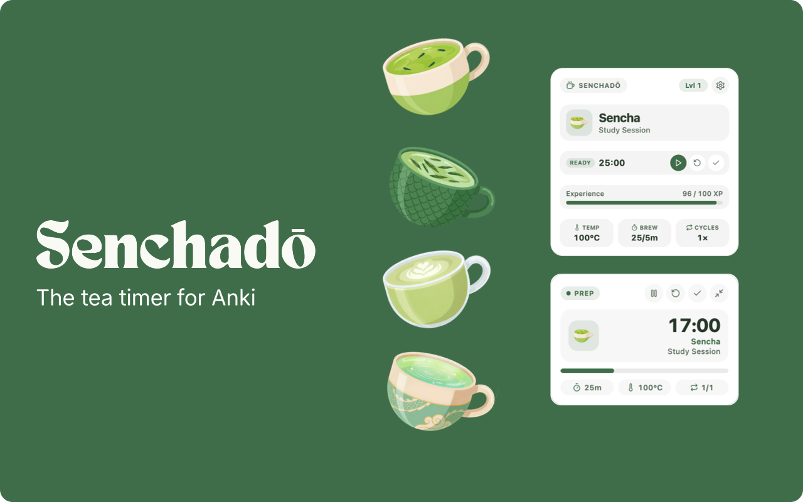

  

<h1 align="center">
	Senchado
</h1>

**Senchadō** is a simple, minimal, modern and gamified tea timer for Anki, allowing you to visualize the time you spend studying, earn XP and unlock teas! 

**Senchadō** (煎茶道; "way of sencha") is a Japanese word for the ceremonial preparation of the Sencha (green tea), being an old ritual passed through generations after being popularized by Baisao, the first Senchadō master. Just like preparing tea, studying involves focus, patience and practice, and this is the feeling I want to bring with Senchadō Timer for Anki, a fun way of understanding and tracking your rhythm while reviewing.

## Features

### 🍵 Tea House
The main menu to set your Senchadō workflow.
- **Brewing Configurations**: Configure **Preparation** (Study), **Brewing** (Break), and number of **Cycles**.
- **Customize main menu and reviewer widgets**: Customize the main menu widget, position of timer on reviewer, turn sound notifications on and off, and more.
- **Check your progress**: Check your level progress, teas available, and past tea brewing sessions (30 days).

### 🍵 Tea Timer on Reviewer
Flexible and minimal tea timer.
*   **Cycles**: Check **Preparation** (Study), **Brewing** (Break), number of **Cycles**, and other useful information (can be minimized).
*   **Smart Timer**: Runs in the background and notifies you when your session is complete.
*   **Sounds**: Gentle notification sounds for timer completion (can be silenced in settings).

### 🍵 Gamification
*   **Level Up**: Earn XP while reviewing and studying, simple like that: study more, evolve faster.
*   **Unlock Teas**: Progress through **100 levels** to unlock over **15 unique tea flavors**, from classic *Sencha* and *Matcha* to rare *Da Hong Pao* and *Gold-coated Tea*.

## 🍵  More of Senchadō

